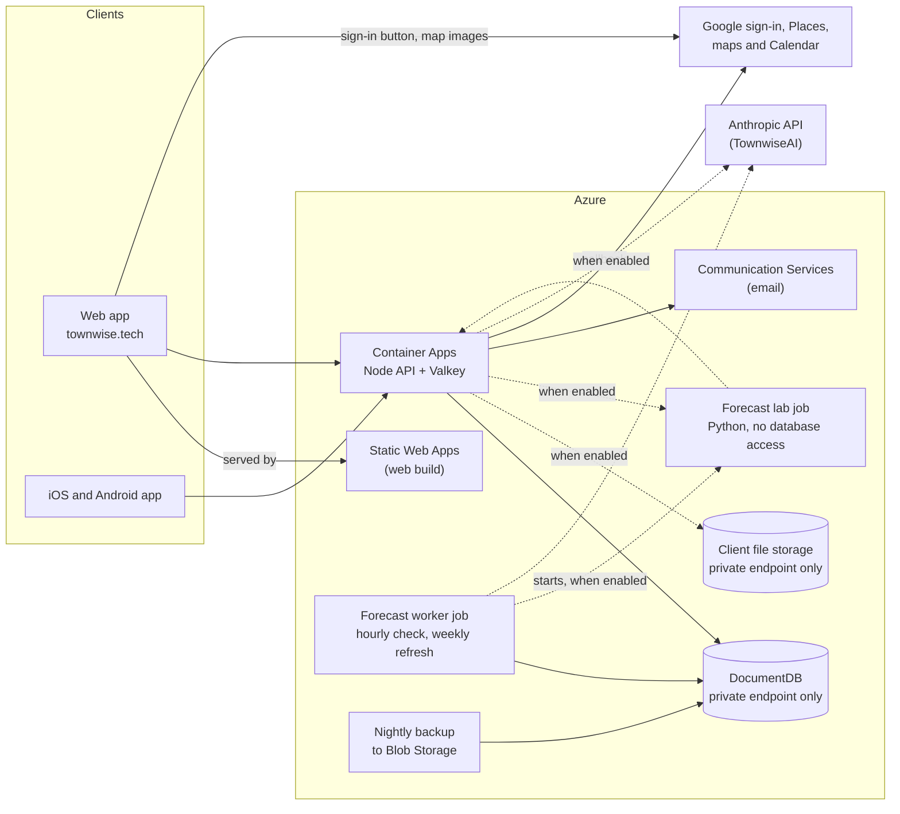

# Townwise

Townwise forecasts daily guests for restaurants and bars in small towns, three months ahead with a rougher outlook to a year, from the town's own calendar instead of the region's.

It is our course project for ENGG 119, AI in the Real World, at Dartmouth's Thayer School of Engineering. We are testing it in Hanover, NH, with a partner restaurant. It is not an official Dartmouth product. The public site is [townwise.tech](https://townwise.tech).

## The idea

In a town like Hanover, restaurant demand follows things a regional forecast never sees: the academic calendar, Commencement, sporting events, tourism, and a population that grows and shrinks with the seasons. A forecast built from regional patterns averages those swings away. So the owner orders short for the big weekends and sits on stock in the quiet ones.

Townwise starts from the town and then tunes to the restaurant:

1. **Research the town.** An agent finds the events and seasons that move demand in a town, each with a date and a public source.
2. **Build the forecast.** Models turn that town profile into daily forecasts, each day with a range and a reason (for example "Commencement weekend").
3. **Calibrate to the restaurant.** The owner uploads sales history from their point-of-sale system, and the town model is tuned to their business.
4. **Tune by talking.** TownwiseAI, a chat assistant, lets the owner say what the model cannot see ("we're closed for a private event on the 14th") and saves it as a note on the forecast, with Undo, when the owner said it plainly, and otherwise proposes it for the owner to save. Standing facts ("Closed Mondays") become business rules.
5. **Order from the forecast.** For a bar, Townwise turns item sales, counts and the forecast into the next order for each supplier, each line with a quantity and the reason for it. The owner decides; nothing is sent to a distributor.

The questions we are trying to answer:

- Can an agent that researches a town on its own build a forecast that beats a general one, especially where sales history is thin?
- How much of a restaurant's own history does it take to tune a town model to that restaurant?
- How well can we forecast from public information alone?

## Status

This is an MVP in active development. Townwise does not charge for early access.

| Piece | State |
|---|---|
| Public website: a homepage with a map of twelve Northeast towns, plus about, privacy, terms and security pages | Built. The homepage is web only. |
| Sign-in with Google; two-step sign-in, required for staff | Built |
| Access: request access (with a Google Places search when it is on), invitations from an org admin, approval by staff, and Townwise's access emails (request received, you're in) | Built |
| Portal for a location: Home, TownwiseAI, Calendar, Orders, Analytics, Notes, Rules, Town and Your data, plus Team and Settings | Built (`client/`), on web, iOS and Android. Light and dark mode on web; native is dark only. |
| Sales history: a daily-totals upload read in the browser, or stored files that Townwise reads on the server, all listed in Your data, where a stored file can be opened and viewed in the browser | Built. The daily-totals upload and the file viewer are web only. Stored files are off until `FILES_BLOB_ACCOUNT_URL` is set. |
| TownwiseAI (Claude through the Anthropic API): reads a location's sales, notes, business rules, own calendars, town calendar, people in town, published forecast, orders and Your data; searches the web; draws charts; takes files attached from Your data; lets an org admin start a calibration; proposes notes, order changes and setup for the owner to save, and saves a note the owner stated plainly, with Undo | Built in the API and the app. Off until `ANTHROPIC_API_KEY` is set. |
| TownwiseAI working on its own: it reads each stored file a person adds (the box on Add a file is checked by default), sorts imported calendar files, and saves only what it is sure of (notes, summaries, days a location lacks, closure rules from its weekly suggestions), each change listed in its activity with Undo; anything less certain waits as a question. An org admin can turn it off for the organization | Built, on by default (`TOWNWISE_AGENT_AUTO`, true in production). Needs stored files and `ANTHROPIC_API_KEY`. |
| Calendar and business rules: a month grid or a scrolling week view with each day's published forecast, a forecast chart, the notes and the location's own calendars' events on each day, and standing rules that can carry a forecast schedule | Built |
| Owner calendars: a location's own calendars, each an imported `.ics` or calendar CSV file, a subscription link refreshed in the background, or a connected Google calendar, managed from the Calendar page's Your calendars and listed as items in Your data (a calendar file dropped there becomes a calendar), read by TownwiseAI | Built. Links and Google calendars are off until `TOWNWISE_CALENDAR_KEY` is set; Google calendars also need `TOWNWISE_GOOGLE_CALENDAR_CLIENT_ID` and `TOWNWISE_GOOGLE_CALENDAR_CLIENT_SECRET`. Connecting a Google calendar and importing a file are web only. |
| Bar ordering: Orders (the next order per supplier) and Ordering setup (suppliers, items, item sales upload, counts) | Built, with the order math a TypeScript port of the core of the `reorder/` engine. The item sales upload and the sheet import are web only. |
| Staff console: an overview, requests, organizations (including setup of one nobody has joined yet), people, the audit log, audited "view as" and "open as admin", forecast import and publish, calibrations and the forecasts switch | Built, web only |
| Forecasts in the app | Built. The forecast lab refits a location's model in a job on Townwise's servers: staff start a calibration from the console, an org admin can ask TownwiseAI to start one, and a weekly worker job refreshes every location with enough history with no one starting anything. A run publishes only when it passes a quality gate and the organization's forecasts are on (the default; staff can switch them off). A published run covers 91 days as the forecast and then a rougher outlook up to a year ahead. Staff can still import and publish a run made on the team's computers. The lab and the weekly refresh are off until `TOWNWISE_LAB_RUNNER` is set. |
| Town research agent | Not built. Dartmouth's 2025-26 calendar (terms, finals, Commencement, home games and more) is in `modeling/dartmouth_calendar_2025_2026.csv`, every date with a source, and the API's town calendar for Hanover is seeded from it. No other town has calendar entries yet. |
| Forecasting models | A first demand model for our partner restaurant is in `modeling/demand_model_v0.ipynb`. Its forecasts for Oct 22 to Dec 31, 2026 were frozen on Nov 1, to be scored against actual sales. `modeling/lab` packages its guest model for the forecast lab. |

## How it fits together



- **Client** (`client/`): one React Native app built with Expo and Expo Router, for iOS, Android and the web. The homepage, the daily-totals and item sales uploads, the file viewer and the staff console are web only. The rest of the signed-in portal runs on every platform.
- **API** (`api/`): one Node.js and Express process. It mounts sign-in under `/auth`, the Townwise product under `/api`, and the forecast lab's callbacks under `/lab`. Every `/api` route declares who may call it (signed in, member, org admin or staff) in one table, `api/src/access/routes.ts`, and each organization's data is isolated from every other's (pinned by `api/test/isolation.test.ts`). The same process runs the background workers for stored files, TownwiseAI's file reads, calendar links and chat turns. The weekly forecast refresh runs outside it, in a Container Apps job that starts every hour from the API's image, starts the forecast lab for each location that is due and writes TownwiseAI's weekly suggestions. The lab is a Python job (`modeling/lab`) with no database access: it reads its input from the API and posts its result back over HTTPS.
- **Shared backend modules** (`api/kit/`): sign-in and sessions, MongoDB, Redis, rate limiting, and the HTTP server core. They were copied from a reusable module kit (versions in [`KIT.md`](KIT.md)) and are owned here. `client/` came from the same kit.
- **Infrastructure** (`infra/`): Terraform for Azure. The database and the client file storage accept connections only from inside the private network. Secrets live in Key Vault, and deploys run from GitHub Actions without long-lived keys. Expected cost is about $58 a month at low traffic; TownwiseAI and the Places search bill Anthropic and Google directly ([`infra/README.md`](infra/README.md), Monthly cost).
- **Research** (`eda/`, `modeling/`) and **ordering** (`reorder/`): Python projects set up with uv. The notebooks read the private exports in `data/`, so they only run where a teammate has copied those in.

## Repository map

| Path | What it holds |
|---|---|
| `api/` | The Townwise API (`api/src/`): access rules, organizations and locations, sales and stored files, notes, business rules, owner calendars, orders, forecasts, TownwiseAI, team and the staff console |
| `api/kit/` | Kit modules the API is built from (`auth`, `mongo`, `redis`, `rate-limit`, `server-core`) |
| `client/` | The Expo app: marketing site, sign-in, the client portal, TownwiseAI and the staff console |
| `infra/` | Azure Terraform (`bootstrap`, `production`), operations scripts, web hosting headers, and the laptop CI runner (`ci-runner/`) |
| `docs/` | Milestones and course write-ups. `docs/portal/` holds the build spec for the portal and staff console, the TownwiseAI contract and the estimates contract. `docs/REORDER_SPEC.md` is the bar reorder spec. |
| `openspec/` | OpenSpec changes: a proposal, design, spec deltas and task list for each larger change |
| `.claude/` | The OpenSpec commands and skills for Claude Code |
| `data/` | Private sales exports from our partner restaurant. Only the README is in git. |
| `eda/`, `modeling/` | Exploratory analysis, the demand model and the forecast lab package (`modeling/lab`). Generated outputs stay local; `modeling/forecasts/` keeps frozen forecasts so they can be scored honestly later. |
| `reorder/` | The bar reorder module: the order engine, price suggestions, a backtest and a Streamlit mockup |
| `config/` | The reorder module's settings: the partner restaurant's ordering values and New Hampshire purchasing rules |
| `compose.yaml` | Local MongoDB, Valkey and Azurite (blob storage) for development |
| `.github/` | CI, security scans, secret scanning and the deploy workflow |

### Size

A snapshot from 2026-11-19 (1,467 commits since 2026-11-01): about 1,870 tracked files and 320,000 lines, counted with `wc -l`, so blank lines and comments are included.

| Area | Lines |
|---|---|
| TypeScript, all (`.ts`, `.tsx`, `.mts`) | 281,000 |
| `client/app` and `client/src` | 74,000 |
| `client/test` | 74,000 |
| `api/src` | 54,000 |
| `api/test` | 67,000 |
| `api/kit/*` source and tests | 4,000 and 7,000 |
| Python (`modeling/`, `reorder/`) | 13,000 |
| Markdown (11,000 of it in `openspec/`) | 21,000 |
| Terraform | 4,700 |

About half the TypeScript is tests. To recount one area: `git ls-files -z -- 'api/src/*.ts' | xargs -0 cat | wc -l`.

## Run it locally

You need [nvm](https://github.com/nvm-sh/nvm) (for Node 24) and Docker. From the repository root:

```sh
nvm use                     # Node 24, from .nvmrc; npm refuses older versions
npm ci
docker compose up -d        # MongoDB on 27017, Valkey (Redis) on 6379 and Azurite (blobs) on 10000

# API settings: copy the example and generate two local-only keys
grep -v -E '^AUTH_(JWT|ENCRYPTION)_KEYS=' api/.env.example > api/.env.local
printf 'AUTH_JWT_KEYS=k1:%s\nAUTH_ENCRYPTION_KEYS=e1:%s\n' "$(openssl rand -base64 32)" "$(openssl rand -base64 32)" >> api/.env.local

az login                         # required; the API and the web app refuse to start without it
npm run dev -w @townwise/api          # API on http://localhost:8080; developer secrets come from Key Vault
curl localhost:8080/healthz           # {"status":"ok"}
```

A non-interactive shell may start on an older Node. If `node --version` is not 24, run `. "$HOME/.nvm/nvm.sh" && nvm use` first.

`az login` has to succeed before the API listens. The dev script reads the developer Key Vault secrets (the Google web client id, the calendar client secret, the calendar key, the shared Anthropic key, and the Places and map secrets) into the process. A non-empty value in `api/.env.local` replaces the Key Vault value for that name, and that secret is not read. The script does not write the Key Vault values into the file. If the sign-in is missing, or a required secret cannot be read and the file does not already set it, it prints the reason and exits. The two `AUTH_*_KEYS` lines stay in `api/.env.local`: they are throwaway local keys, not the production ones.

For the app, copy `client/.env.example` to `client/.env.local` and set `EXPO_PUBLIC_API_URL=http://localhost:8080` and `EXPO_PUBLIC_WEB_URL=http://localhost:8081`, then:

```sh
npm start -w @ckeith26/expo-shell     # press w to open the web app on http://localhost:8081
```

`npm start` makes the same Azure sign-in check and loads the public Google web client id from Key Vault into `EXPO_PUBLIC_GOOGLE_WEB_CLIENT_ID` for that process. A non-empty `EXPO_PUBLIC_GOOGLE_WEB_CLIENT_ID` in `client/.env.local` replaces it. The client secret is not loaded. The OAuth client still needs `http://localhost:8081` as an authorized JavaScript origin in Google Cloud. Use `localhost`, not `127.0.0.1`: the browser treats them as different sites, and the session cookie will not carry over. The `.env.local` files are gitignored; never commit them.

The optional services stay off until their Key Vault secrets exist: TownwiseAI needs `anthropic-dev-key`, stored files need `FILES_BLOB_ACCOUNT_URL` (and, locally, `FILES_AZURITE_CONNECTION_STRING` for Azurite, which stays in `api/.env.local`), the Places search needs its three secrets, calendar links need `townwise-calendar-key`, Google calendars need that plus `google-web-client-id` and `townwise-google-calendar-secret`, and the forecast lab and its weekly refresh need `TOWNWISE_LAB_RUNNER`. The dev script loads the secrets that are present. A required one that is missing stops the start. TownwiseAI working on its own (`TOWNWISE_AGENT_AUTO`), the weekly refresh (`TOWNWISE_WEEKLY_FORECASTS`) and weekly suggestions (`TOWNWISE_WEEKLY_SUGGESTIONS`) default to on once the services they need are set. [`api/README.md`](api/README.md) has the full local setup (staff addresses, two-step sign-in, email) and every environment variable.

## Tests and checks

```sh
npm run verify      # what CI runs: dependency check, lint, typecheck, every test, web export, expo-doctor
npm test            # every workspace's tests (integration tests start their own databases in Docker)
npm run lint
npm run typecheck
```

To run one test file or one test:

```sh
npm test -w @townwise/api -- test/notes.int.test.ts
npm run test:unit -w @townwise/api               # or test:int for the integration half
npm test -w @ckeith26/expo-shell -- test/auth/store.test.ts -t "routeFor"
npm test -w @ckeith26/expo-shell -- test/marketing/links.test.ts --selectProjects web
```

The API and the kit modules use vitest, with a `unit` project (`*.test.ts`) and an `integration` project (`*.int.test.ts`, which needs Docker). The client uses jest-expo with a `native` and a `web` project; put the test path before `--selectProjects`, or every suite runs. A `*.test.native.tsx` file runs on native only, `*.test.web.tsx` on web only, and a plain `*.test.ts` in both.

The Python packages have their own tests. From `modeling/lab/` or `reorder/`:

```sh
uv sync
uv run pytest
```

Every pull request runs three workflows: **CI** (verify plus the iOS and Android exports, the Terraform checks, a guard on which workflow jobs can get a deploy token, and the `modeling/lab` and `reorder/` tests), **Security** (dependency vulnerabilities, static analysis, infrastructure policy) and **Gitleaks** (secret scanning). Pushes to `develop` and `main` also run CI, and pushes to `main` run **Deploy**. When GitHub-hosted runners are unavailable, the checks (never Deploy) can run on a laptop runner ([`infra/README.md`](infra/README.md), CI on the laptop runner).

## Research notebooks

`eda/` and `modeling/` are uv projects. Run these from inside each folder:

```sh
uv sync                               # .venv from pyproject.toml and uv.lock
uv run jupyter lab
uv run jupyter nbconvert --to notebook --execute --inplace demand_model_v0.ipynb
```

The notebooks read the private exports in `data/`, so they only run where a teammate has copied those in ([`data/README.md`](data/README.md)). `demand_model_v0.ipynb` refuses to overwrite the frozen forecasts in `modeling/forecasts/`.

## Deployment

Merging into `main` deploys, once the `DEPLOY_ENABLED` repository variable is `true`. The workflow runs on camo's self-hosted deploy runner while GitHub-hosted runners are unavailable. It builds and deploys only the services whose files changed since its last successful run (web, API, lab; a manual run deploys all three): it builds the web export and the images, pushes the images to Azure, points the API, the lab job and the weekly forecast worker at them, uploads the web build, then checks the API's health. A release is a pull request from `develop` into `main`; once it is live it gets an annotated `vYYYY.MM.DD` tag and a GitHub Release. The full setup, release, rotation, backup, restore and teardown runbook is [`infra/README.md`](infra/README.md).

## Data and privacy

The sales data in `data/` comes from our partner restaurant's point-of-sale exports and is private. It is gitignored and shared only between teammates. Some item names in those exports contain customers' or groups' names, so nothing derived from them (notebook outputs, files, screenshots) may show those names, and none of it leaves the team. The frozen forecasts in `modeling/forecasts/` are committed on purpose: they hold daily forecast figures and no names.

The product follows the same rule. The daily-totals upload sends only the date, guest count and net sales for each day; the file itself never leaves the browser. The item sales upload for ordering sends only matched servings per item per day, and names that match no item never leave the browser. Stored files, when they are on, keep an export as it was sent in a private storage account. While TownwiseAI works on its own (on by default; an org admin can turn it off), it reads each stored file whose box was left checked when it was added; the box can be unchecked per file. When TownwiseAI is on, chat messages and the location data it reads go to Anthropic. Logs and audit events carry only the fields on a fixed list per action (mostly ids and counts), never sales figures, note text, chat messages or file contents.

## Contributing

- Branch from `develop` and open pull requests against `develop`. `main` is production: a release pull request merges `develop` into it, and that merge deploys.
- The repository is on GitHub Free, so only the owner has write access and merges. Teammates have Read access and will send pull requests from forks; forking is still off in the organization settings ([`infra/README.md`](infra/README.md), step 12).
- Run `npm run verify` before opening a pull request.
- Commit messages follow [Conventional Commits](https://www.conventionalcommits.org/), for example `feat: add notes list screen`.
- Larger changes go through [OpenSpec](openspec/): each change in `openspec/changes/<name>/` has a proposal, a design, spec deltas and `tasks.md`, made and worked through with the `/opsx:propose`, `/opsx:apply` and `/opsx:archive` commands in `.claude/commands/opsx/`. The `openspec` CLI is the global npm package `@fission-ai/openspec`.
- The docs are the spec, so change them with the code: [`api/README.md`](api/README.md) for routes, flows, collections and environment variables, and [`docs/portal/spec.md`](docs/portal/spec.md) for the build spec. In the specs, `[CONFIRM: ...]` marks a shipped default awaiting the team's sign-off and `[DECISION NEEDED: ...]` marks an open gap; neither is resolved without a team decision.
- Changes to the kit modules in `api/kit/` or `client/` are recorded under `## Local changes` in that module's `MODULE.md`, with the test that covers them.
- Everything is pinned: dependencies to exact versions at least 7 days old (`.npmrc`), container images by digest, and GitHub Actions by commit SHA.
- Never commit `data/` or `modeling/outputs/`, and never edit or regenerate the files in `modeling/forecasts/`.

## Further reading

| Document | Read it for |
|---|---|
| [`api/README.md`](api/README.md) | Roles and permissions, sign-in and access flows, every API endpoint, rate limits, data and settings |
| [`docs/milestones.md`](docs/milestones.md) | The planned milestones, in order |
| [`docs/portal/spec.md`](docs/portal/spec.md) | The full build spec for the client portal and staff console |
| [`client/src/portal/README.md`](client/src/portal/README.md) | Which file owns each portal page, and the pieces the pages share |
| [`docs/portal/tuning-chat.md`](docs/portal/tuning-chat.md) | How TownwiseAI works and what it may do |
| [`docs/portal/estimates.md`](docs/portal/estimates.md) | People in town, the town calendar and how forecast runs are imported and read |
| [`client/MODULE.md`](client/MODULE.md) | The app's security model, required web headers and launch blockers |
| [`infra/README.md`](infra/README.md) | The Azure setup, operations runbook, releases, monthly costs and known risks |
| [`reorder/README.md`](reorder/README.md) | The reorder module, its tests, mockup and backtest |
| [`docs/REORDER_SPEC.md`](docs/REORDER_SPEC.md) | The bar reorder agent's build spec |
| [`openspec/`](openspec/) | The OpenSpec changes in progress |
| [`KIT.md`](KIT.md) | Which kit commit each module was copied from |
| [`data/README.md`](data/README.md) | What the private sales exports contain |
| [`modeling/README.md`](modeling/README.md) | The demand model, the frozen forecasts, the forecast lab and how to re-run them |
